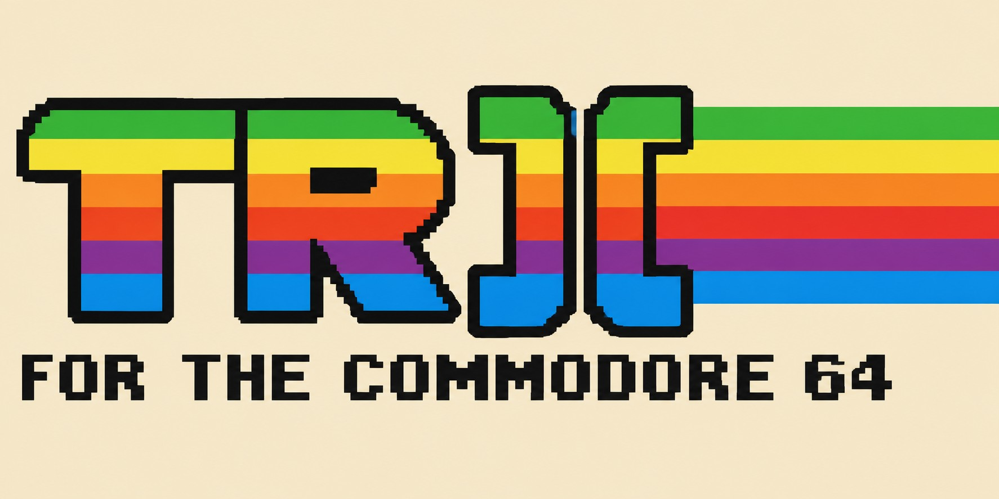

<p align="center"></p>

# TR ][ — an Apple ][ Plus for the TeensyROM+

TR ][ is a 64K Apple ][ Plus that runs on the Teensy 4.1 inside a [TeensyROM+](https://github.com/SensoriumEmbedded/TeensyROM),
as a Host Extension module under upstream TeensyROM's stock VM host. Nothing in the TeensyROM firmware is
changed. The Commodore 64 becomes the Apple's screen, keyboard, speaker and joystick:

- **Screen:** the 40-column text screen, and hi-res written straight into C64 memory by the TeensyROM+'s
  C64 transfer, below a raster split (mixed mode keeps four text lines). Each 8x8 cell gets the two Apple
  colours that cover most of it.
- **Keyboard:** typed on the C64 and sent to the Apple as Apple keys.
- **Speaker:** the Apple's clicks are followed by a tone tracker and played on SID voice 1.
- **Joystick:** port 2 becomes the Apple's paddles 0 and 1 and button 0.

## What it runs

- **The Oregon Trail** (MECC, 1985, the 3.5-inch 800K version), from a block image on the SD card, start
  to finish: title, store, rivers, the hunt (aim with the stick, fire with the button), tunes on the SID.
- **Our own Monitor** and an **Applesoft-compatible BASIC** converted from Microsoft's BASIC-M6502.
- **Disk images in slot 5 as a block device:** `.po` (140K or any whole number of 512-byte blocks),
  `.dsk` and `.do` (140K, DOS 3.3 order) and `.2mg`. A Disk II drive for 5.25-inch DOS 3.3 disks is the
  next step; until then a DOS 3.3 disk is readable but does not boot.

You bring your own disk images. None are included, and none ever will be.

## What you need

- A **TeensyROM+** on firmware 0.9 with upstream's stock extension host (`VMBOOT09.TRH`), and an NTSC
  Commodore 64 (PAL is untested).
- A joystick in **port 2** for games that use one. A stick whose fire button reads as held all the time
  blocks some keys while it is plugged in.
- Your own disk images.
- To build: macOS or Linux with the tools listed below (we build and test on macOS).

## Build

```bash
git clone https://github.com/SensoriumEmbedded/TeensyROM.git teensyrom-build
git -C teensyrom-build checkout 53b3d3d144e983b1b9f734bd22efd352e6af4a6d
make                      # the ROMs, the slot card and a2term (the emulator in a Mac or Linux terminal)
make test                 # every test; the ones that need your own disk images skip when they are absent
make package ID=APPLE2 FTYPE=a2,po    # the extension package, built by upstream's packager
```

The CPU test needs Klaus Dormann's 6502 functional test (GPL-3.0), fetched on its own:

```bash
mkdir -p third-party/dormann
D=https://raw.githubusercontent.com/Klaus2m5/6502_65C02_functional_tests/master/bin_files
curl -L -o third-party/dormann/6502_functional_test.bin $D/6502_functional_test.bin
```

## Install a package

`make package ID=X FTYPE=...` writes `build/ext-X/`. Copy `build/ext-X/X.crt` to the root of the
TeensyROM's SD card and `build/ext-X/VMS/X/` (three files) to `/VMS/X/`. Then, in the TeensyROM menu:

- select `X.crt` to start at the Monitor (Ctrl-B starts BASIC), or
- select a disk image whose extension the package claims (`FTYPE`, for example `po`): it boots from slot 5.

The TeensyROM does not overwrite files, so give each new build a new `ID`. With the TeensyROM's TCP
listener on, `teensyrom-tools/launch.py post FILE /SD/PATH` copies a file over the network; give the
TeensyROM's address as the last argument or in `TR_HOST`.

On the C64: F1 is the Apple's Reset, F7 goes back to the TeensyROM menu, F5 types the CAVE DIVER demo into
BASIC, F3 shows a key readout. RUN/STOP is Ctrl-C and the `<-` key is Esc.

## Your own disk images

- **The Oregon Trail:** your own copy as a WOZ 2 file at `disks/the-oregon-trail-800-k.woz` (a folder or a
  link). `make` turns it into the SD card's block image, `build/sd/OREGON.PO`, and `build/sd/OREGON.BAD`,
  the list of blocks the real drive cannot read: its copy protection answers there as on real hardware
  (emulated, never patched). Copy both to the card side by side.
- **DOS 3.3 system disks** of your own in `disks/dos33/` (or `DOS33_DIR`) let the disk tests read their
  catalogs; `tools/dos33-files.py` lists and extracts their files.

## Layout

```
emu/          the 6502 core, the Apple ][ Plus machine, disk images, the tone tracker and the stick mapping
              (portable C99, shared by the Mac and the Teensy)
rom/          our Monitor, our BASIC (Microsoft's BASIC-M6502, made Applesoft-compatible) and the slot-5 card
teensy/       the TeensyROM+ module, and its test against upstream's native fake host
c64client/    the C64 side: the cartridge client (ACME)
mac/          a2term, the emulator in a terminal, with a headless test mode (and WAVs of the speaker and a SID voice)
tests/        every test; `make test` runs them all
tools/        woz-to-po, dos33-files and the other Apple ][ tools the build and tests use
programs/     BASIC programs the module can type in (CAVE DIVER)
third-party/  Microsoft's BASIC-M6502 source (MIT, with its LICENSE)
teensyrom-tools/  (in the published copy) small scripts that talk to the TeensyROM's TCP listener
```

## Everything a full rebuild needs

Versions are the ones we build with (macOS 27.2.1, Apple silicon). Others probably work; only
these are tested.

### Source

- **Upstream TeensyROM** (MIT), commit `53b3d3d144e983b1b9f734bd22efd352e6af4a6d`:
  https://github.com/SensoriumEmbedded/TeensyROM
  (the commit: https://github.com/SensoriumEmbedded/TeensyROM/commit/53b3d3d144e983b1b9f734bd22efd352e6af4a6d).
  Clone it as `teensyrom-build` here. We changed nothing in it.
- **Microsoft BASIC-M6502** (MIT), commit `7460af2c03ae19c0e60ff327489229d2005b9357`:
  https://github.com/microsoft/BASIC-M6502. Already included in `third-party/basic-m6502/`;
  `rom/basic.s` was converted from it.
- **Klaus Dormann's 6502 functional test** (GPL-3.0), for the CPU test:
  https://github.com/Klaus2m5/6502_65C02_functional_tests (folder `bin_files/`).
- **Your own The Oregon Trail** (MECC A-157 v1.4, 3.5-inch 800K) as a WOZ 2 file. Not included,
  and not needed for anything but the Oregon Trail tests. The format:
  https://applesaucefdc.com/woz/reference2/

### Tools

- **Xcode Command Line Tools** (`cc`, `c++`, `make`, `git`): `xcode-select --install`.
  We use Apple clang 21.0.0. `xxd` comes with macOS.
- **Homebrew**, https://brew.sh/, then `brew install cc65 acme node arduino-cli python`:
  - cc65 2.19 (`ca65`, `ld65`): https://cc65.github.io/ (source https://github.com/cc65/cc65)
  - ACME 0.97, the C64 client's assembler: https://sourceforge.net/projects/acme-crossass/
  - Node.js 24 or later (we use 26.13.0), for upstream's packager: https://nodejs.org/
  - Python 3 (we use 3.15.2; the tools use the standard library only): https://www.python.org/downloads/
  - arduino-cli 1.6.0, to install the Teensy core and build upstream's firmware:
    https://arduino.github.io/arduino-cli/latest/

### The Teensy Arduino core and libraries

- **Teensy core (Teensyduino) 1.61.0.** It brings the ARM compiler (`teensy-compile` 11.3.1, Arm
  GNU Toolchain 11.3.Rel1) that the packager looks for under `~/Library/Arduino15`, and the
  Teensy libraries. Board manager index: https://www.pjrc.com/teensy/package_teensy_index.json

  ```bash
  arduino-cli core update-index --additional-urls https://www.pjrc.com/teensy/package_teensy_index.json
  arduino-cli core install teensy:avr@1.61.0 --additional-urls https://www.pjrc.com/teensy/package_teensy_index.json
  ```

  Or install Teensyduino with the Arduino IDE: https://www.pjrc.com/teensy/td_download.html.
  The core's source: https://github.com/PaulStoffregen/cores
- **Libraries upstream's firmware uses** (only for rebuilding the stock extension host): Bounce,
  EEPROM, NativeEthernet with FNET, SD, SPI and Time (`TimeLib.h`) come with the Teensy core.
  **CRC32** 2.0.1 by Christopher Baker does not: `arduino-cli lib install CRC32@2.0.1`
  (https://github.com/bakercp/CRC32).
- **Without the Teensy core**, the packager also takes any `arm-none-eabi-g++` on PATH or
  `--toolchain`: https://developer.arm.com/downloads/-/arm-gnu-toolchain-downloads
  (the firmware build still needs the core).

### Hardware

- A **TeensyROM+** with firmware 0.9 (https://github.com/SensoriumEmbedded/TeensyROM/releases),
  and upstream's stock extension host built from the same commit (`npm run build:tr-plus` in
  `teensyrom-build`), copied to `/c64max/VMBOOT09.TRH` and selected in the TeensyROM menu.
- An NTSC Commodore 64 (PAL is untested).

## Credits and licences

- **Ours:** MIT, see `LICENSE`.
- **TeensyROM** by Travis Smith (MIT, https://github.com/SensoriumEmbedded/TeensyROM): the Host Extension
  ABI, the stock VM host, the packager and the native fake host this is built on, and the reference client
  and module that our C64 client and module follow. Its licence is in `third-party-notices/`. Running a
  whole Apple ][ as an ordinary extension under the stock host only works because the TeensyROM+ was
  designed so well for exactly this kind of thing.
- **Microsoft BASIC-M6502** (MIT, https://github.com/microsoft/BASIC-M6502): the 1978 source in
  `third-party/basic-m6502/` with its licence; `rom/basic.s` was converted from it and edited by hand
  (lines tagged `[OURS]`).
- **Klaus Dormann's 6502 functional test** (GPL-3.0): not included; fetched for the CPU test.
- No Apple or MECC software is included. The Monitor is our own, written from Apple's published
  documentation of its entry points and behaviour (see the notes at the top of `rom/monitor.s`).
